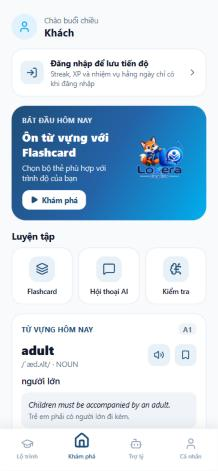

<p align="center">
  
</p>

<h1 align="center">SmartEnglish AI — Ứng dụng học viên (Loxera English)</h1>

<p align="center">
  
  
  
  
  
</p>

Ứng dụng di động (Android, iOS, web) cho **học viên** và **khách vãng lai** của hệ thống SmartEnglish AI.
Giáo viên và quản trị viên dùng [`smartenglish-admin`](../smartenglish-admin); dữ liệu đi qua API Gateway của [`smartenglish-ai-backend`](../smartenglish-ai-backend).

| Trang chủ (khách) | Gia sư AI |
|---|---|
|  |  |

---

## 1. Chức năng

| Nhóm | Chức năng |
|---|---|
| Bắt đầu | Màn chào, đăng ký / đăng nhập (email, Google, OTP), chọn mục tiêu, **kiểm tra trình độ** (placement test) |
| Trang chủ | Streak, XP, xu; thẻ "Tiếp tục học" theo bộ thẻ thật; **nhiệm vụ hằng ngày** (nhận thưởng XP); **từ vựng hôm nay** lấy từ kho từ vựng |
| Lộ trình học | Bản đồ bài học theo cột mốc, bài học chi tiết, phân tích lỗ hổng kiến thức |
| Flashcard | Bộ thẻ hệ thống theo chủ đề, bộ thẻ cá nhân, ôn tập **SRS** (Again / Hard / Good / Easy), tra từ nhanh |
| Luyện nói | Luyện phát âm từng từ (phân tích âm tiết IPA, hướng dẫn khẩu hình), hội thoại theo kịch bản với AI; bộ lọc chủ đề trên thanh tìm kiếm |
| Đề thi & quiz | Danh mục đề TOEIC / IELTS, làm bài theo phần, xem kết quả và giải thích |
| Đọc & nghe | Bài đọc có dịch, bài nghe có phụ đề song ngữ, tạo bài đọc theo chủ đề |
| Gia sư AI | Chat với Gemini theo trình độ, nhập bằng giọng nói, đọc câu mẫu |
| Quét ảnh | Chụp đồ vật → nhận diện từ vựng → lưu vào bộ thẻ |
| Lớp học | Tham gia lớp bằng mã, xem và nộp bài giáo viên giao |
| Cộng đồng | Bài đăng, kết bạn (danh bạ người dùng thật), nhắn tin realtime |
| Xếp hạng | Bảng xếp hạng XP theo tuần |
| Gói dịch vụ | Xem gói, thanh toán VietQR (SePay), khoá gói thấp hơn gói hiện tại, **huỷ gói & yêu cầu hoàn tiền**, hoá đơn |

### Khách vãng lai (không cần tài khoản)

Bấm **"Dùng thử không cần tài khoản"** ở màn chào để vào:

- Trang chủ và từ vựng hôm nay
- **Học bộ thẻ hệ thống** (tab "Hệ thống"; tab "Của tôi" yêu cầu đăng nhập)
- Luyện phát âm từng từ, xem danh mục đề thi, tra từ

Các chức năng gắn với dữ liệu cá nhân (bộ thẻ của tôi, cộng đồng, lớp học, quét ảnh, thông báo, thống kê, nhiệm vụ) hiện lời mời đăng nhập.

### Nguyên tắc giao diện

- Không dữ liệu giả: mọi danh sách, số liệu, ảnh đại diện lấy từ API; không có dữ liệu thì hiện trạng thái rỗng.
- Ảnh đại diện mặc định là biểu tượng người dùng, không dùng ảnh người thật minh hoạ.
- Icon `lucide-react-native` đơn sắc, không emoji; màu lấy từ `src/theme/colors.ts`.
- Mỗi màn có đủ 4 trạng thái: đang tải, rỗng, lỗi, có dữ liệu.

## 2. Công nghệ

| Nhóm | Thư viện |
|---|---|
| Nền tảng | Expo SDK 57, React Native 0.86, Expo Router (định tuyến theo file) |
| Giao diện | NativeWind 4 (Tailwind), Reanimated 4, Gesture Handler, lucide-react-native |
| Dữ liệu | Axios (`apiClient` duy nhất, tự gắn JWT và refresh khi 401), TanStack Query, Zustand |
| Âm thanh | expo-speech (TTS), expo-audio / expo-av (ghi âm, phát audio) |
| Camera | expo-image-picker, VisionCamera |
| Kiểm tra kiểu | TypeScript strict, Zod |

## 3. Cấu trúc thư mục

```
app/                       # Expo Router
├── (auth)/                # welcome, login, register, verify-otp, placement-*
├── (student)/             # home, learn, review/*, practice/*, classes/*, feed, profile/*, …
└── (teacher-companion)/   # màn đồng hành cho giáo viên
src/
├── core/                  # api/client.ts, flows/ (authStore, roleGateStore), components/, storage/
├── features/<tên>/        # application/ (hooks) · data/ (API) · presentation/ (screens, components)
└── theme/                 # colors.ts, typography.ts, gradients.ts
```

## 4. Cài đặt & chạy

Yêu cầu: Node.js 20+, backend đang chạy (API Gateway cổng 8080), thiết bị có **Expo Go** hoặc máy ảo.

```bash
npm install
npm run start        # quét QR bằng Expo Go
npm run web          # bản web tại http://localhost:9000
npm run android      # máy ảo Android
npm run typecheck    # tsc --noEmit
npm test             # Jest
```

Biến môi trường (`.env`):

| Biến | Ví dụ | Ý nghĩa |
|---|---|---|
| `EXPO_PUBLIC_API_URL` | `http://localhost:8080` | Địa chỉ API Gateway |
| `PORT` | `9000` | Cổng Metro |

Nếu không đặt `EXPO_PUBLIC_API_URL`, app tự dò: web dùng `localhost:8080`, Expo Go dùng IP LAN của máy chạy Metro, Android dùng `127.0.0.1:8080` (qua `adb reverse`).

> Thử trên điện thoại khác mạng: chạy `ngrok http 8080` rồi đặt `EXPO_PUBLIC_API_URL` bằng địa chỉ `https://…ngrok-free.dev`. Khi backend đã deploy, dùng `https://api.<domain>`.

## 5. Tài khoản kiểm thử

Liên hệ nhóm thực hiện để được cấp tài khoản thử nghiệm, hoặc dùng chế độ khách vãng lai.

## 6. Thành viên thực hiện

- **Nguyễn Thế Anh** — Sinh viên thực hiện
- **Nguyễn Tuấn Anh** — Sinh viên thực hiện

Đồ án tốt nghiệp: *Hệ thống học tập tiếng Anh thông minh tích hợp trí tuệ nhân tạo (SmartEnglish AI)*. Giải đáp kỹ thuật: [`QUESTION.md`](../QUESTION.md).
